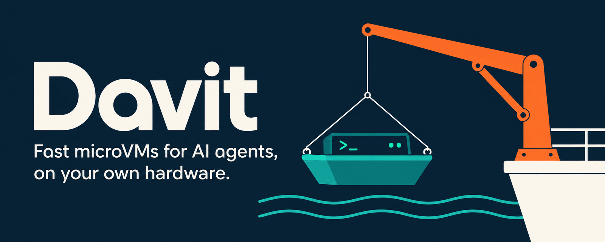

<p align="center"></p>

# Davit

Run your repository's builds and tests in persistent Ubuntu VMs ("project boxes") on your own Linux host, so
AI agents and you stop running them on your laptop. Your editor and coding agent stay on the laptop. Davit
reaches the host over SSH, syncs the worktree, caches the project's dependencies and gives each worktree its
own VM.

**You need:** a Linux host with KVM and SSH key access, and a Mac or Linux laptop. No Davit account is needed,
and Tailscale is optional. Host setup may need one-time administrator commands (KVM permissions, Ubuntu's
AppArmor setting). The installer prints exactly what to run and runs it only if you add `--yes-sudo`.

## Get started in 3 steps

1. **On the host** (a Linux x86_64 box with KVM):

   ```sh
   curl -fsSL https://github.com/jayleaton/davit/releases/download/v0.1.0-rc7/install.sh | sh -s -- --host
   ```

   Davit has release candidates only so far, so the commands name the current one (`releases/latest` starts
   working with v0.1.0). This installs davit and a prebuilt developer image, starts the service and checks the host with
   `davit doctor`. Requirements and fixes: [docs/install-host.md](docs/install-host.md).

2. **On your laptop** (macOS or Linux):

   ```sh
   curl -fsSL https://github.com/jayleaton/davit/releases/download/v0.1.0-rc7/install.sh | sh -s -- --client
   davit connect you@your-host
   ```

   `davit connect` sets up your SSH key on the host, checks davit there and saves it as your default host.

3. **In any of your repositories:**

   ```sh
   cd your-repo
   davit box run -- make test   # or your project's test command
   davit box down               # optional: stops this worktree's VM; its disk is kept
   ```

The first run installs the project's dependencies, so it takes as long as that install. Later runs reuse
them. If a step fails, [docs/troubleshooting.md](docs/troubleshooting.md) has the fix for each error. The long
version of these steps is [docs/quickstart.md](docs/quickstart.md).

## How it works

- **Project image:** the dependencies are installed once, from `.davit/setup.sh` or a setup detected from the repo (mise, `go.mod`, lockfiles, Vite+, a `setup` target), and kept as numbered versions. A JS project's VMs get 4 GiB memory and its `node_modules/.bin` on PATH.
- **One VM per worktree:** each git worktree gets its own persistent instance made from the project image.
- **Sync:** the worktree is copied in before each run, and `davit box sync --pull PATH` brings files back. Sync adds and updates files; a file deleted locally stays in the box.
- **Output:** stdout and stderr stream to your terminal, and davit exits with the command's exit code. An idle VM stops itself after 15 minutes.

## Use it from AI agents

Claude Code, Codex and other coding agents follow instructions in `AGENTS.md` or `CLAUDE.md`. Paste this into
yours:

```markdown
## Heavy commands run in a davit box

This repository runs builds and tests in a davit project box on a Linux host, not on this machine.

- Run tests, builds, dependency installs, benchmarks and other heavy commands with
  `davit box run -- <command>`, from the repository or worktree you are working in. It syncs this
  worktree first and exits with the command's exit code.
- Keep light commands local: editing, git, searching and reading files.
- Bring generated files back with `davit box sync --pull <path>` (coverage reports, build output).
- Files deleted here are not deleted in the box. Delete them there with `davit box run -- rm <path>`.
- When you are done, run `davit box down`.
- If `davit` is missing, or a box command fails because the host is unreachable or full, stop and say so,
  with the error. Do not run the heavy command locally instead. `davit connect --check` shows what is wrong.
```

[docs/project-boxes.md](docs/project-boxes.md) has every box command and flag.

## Optional: Tailscale

The host can also join a tailnet (Tailscale or Headscale). SSH works over it like over any network:
`davit connect you@your-host` with the host's tailnet name. The tailnet gateway adds more: `--host` with the
gateway's name reaches the API without SSH, and you can share VMs with other tailnet users, give apps stable
URLs and open a VM's desktop in a browser. Setup: [docs/network.md](docs/network.md) and
[the tailnet step of the VM tour](docs/vms-and-agents.md#2-davit-init-and-the-tailnet).

## More

- [Quickstart](docs/quickstart.md): the 3 steps in detail, and day-to-day use.
- [Troubleshooting](docs/troubleshooting.md): first-run errors and their fixes.
- [Project boxes](docs/project-boxes.md): every box command, the setup detection, host capacity.
- [VMs and agents](docs/vms-and-agents.md): plain VMs, forks, snapshots, coding agents inside VMs, sharing, the desktop.
- [Storage tiers](docs/storage-tiers.md): a second, larger disk for stopped boxes (cold storage), sizing, setup.
- [Networking](docs/network.md): the tailnet gateway, egress policy, credentials.
- [Benchmarks](docs/benchmarks.md): measured numbers, with hardware and sample counts.
- [Status](docs/status.md): what works, what is verified on real hardware, and what is not yet.
- [Architecture](docs/architecture.md): code layout, crash safety, runtime notes.
- [Migrating from slipway](docs/migrating-from-slipway.md): Davit was called slipway until 2026-10-26.

## Developing

```sh
make check        # every lint, test and build check; must stay green
make build        # bin/davit
```

Contributor rules are in [AGENTS.md](AGENTS.md); the rest (the check stages, the fake runtime, the real-VM
test tier, building a release from a checkout) is in [docs/developing.md](docs/developing.md).

## License

MIT. See [LICENSE](LICENSE).
